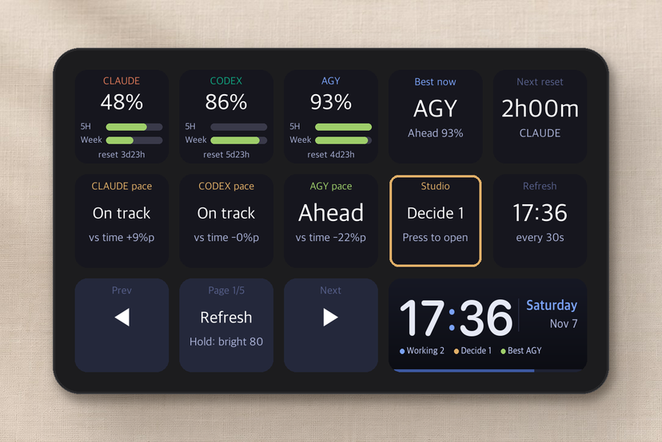
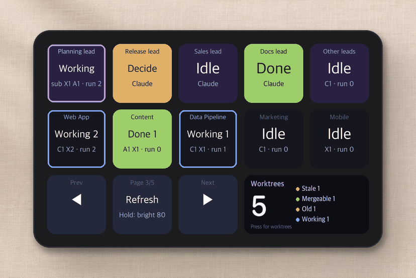
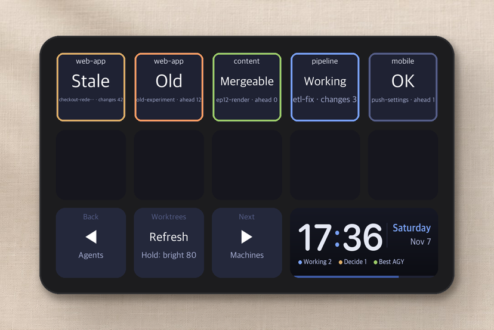
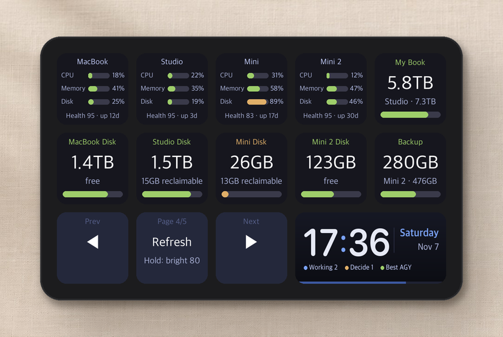
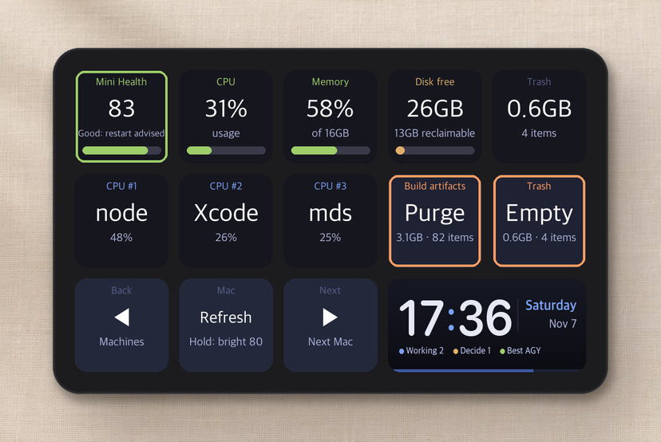
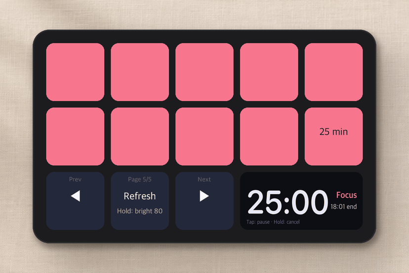
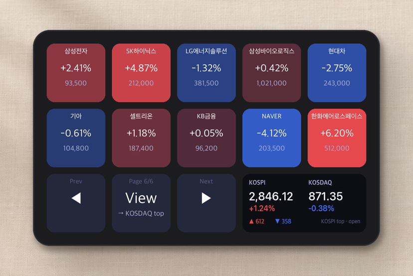

# agentdeck guide

Written for first-time users: **what you need → install → set up each feature**.
You don't have to turn everything on. **LLM quotas and the pomodoro work right after install**; enable the rest as you need it.

[한국어](GUIDE.md) · [Back to README](../README.en.md)

## Contents

1. [What you need](#1-what-you-need)
2. [Install](#2-install)
3. [Screen basics](#3-screen-basics)
4. [Features in detail](#4-features-in-detail)
   - [Remaining LLM quota (pages 1-2)](#41-remaining-llm-quota-pages-1-2)
   - [Agent activity (page 3)](#42-agent-activity-page-3)
   - [Worktrees](#43-worktrees)
   - [Machines and device detail (page 4)](#44-machines-and-device-detail-page-4)
   - [Pomodoro (page 5)](#45-pomodoro-page-5)
   - [Korean stock heatmap (page 6)](#46-korean-stock-heatmap-page-6)
5. [Full config reference](#5-full-config-reference)
6. [Troubleshooting](#6-troubleshooting)
7. [Uninstall](#7-uninstall)

---

## 1. What you need

| Item | Notes |
|---|---|
| **Ulanzi Stream Controller D200** | 13 keys plus one wide screen tile. Pick **the cheapest or any seller you like** from the [AliExpress search results](https://www.aliexpress.com/w/wholesale-ulanzi-d200.html); there's also the [Ulanzi store](https://www.ulanzi.com/products/stream-deck-d200). ⚠️ The similarly named **D200X** (with knobs) and **D200H** are different models and have not been tested. Make sure the listing says just **D200**. |
| **A Mac** | Tested on Apple Silicon. |
| **USB cable** | Plug the included USB-C cable straight into your Mac. |

> 💡 **The firmware is never touched.** This program runs on your Mac and only sends screens to the device. Quit it and the device goes back to normal.

## 2. Install

### 2-1. Check the basics

Open Terminal (search "Terminal" in Spotlight) and run:

```bash
python3 --version   # 3.11 or newer
git --version
```

If either is missing, install [Homebrew](https://brew.sh) and run:

```bash
brew install python git
```

### 2-2. Download and set up

```bash
git clone https://github.com/jakeparkcolde/agentdeck.git
cd agentdeck
python3 -m venv .venv
.venv/bin/pip install -r requirements.txt
cp config.example.json config.json
```

### 2-3. First run

1. **Quit Ulanzi Studio completely**, including its menu-bar icon. Two programs can't drive the device at once.
2. Plug in the device.
3. Run:
   ```bash
   .venv/bin/python dashboard.py
   ```
4. If the screen changes, you're done. Press `Ctrl+C` in Terminal to stop.

### 2-4. Start automatically at login

```bash
./scripts/install-launchd.sh
```

It now starts at login and restarts within 15 seconds if it stops. Unplugging and replugging the device is handled too.

| To do this | Run |
|---|---|
| Restart after editing the config | `launchctl kickstart -k gui/$(id -u)/com.agentdeck.dashboard` |
| Watch the log | `tail -f dashboard.log` |

## 3. Screen basics

```
┌────┬────┬────┬────┬────┐
│ 1  │ 2  │ 3  │ 4  │ 5  │   ← tiles that change per page (10)
├────┼────┼────┼────┼────┤
│ 6  │ 7  │ 8  │ 9  │ 10 │
├────┼────┼────┼─────────┤
│ ◀  │ ⟳  │ ▶  │  wide   │   ← shared buttons + wide tile (clock, etc.)
└────┴────┴────┴─────────┘
```

| Button | Tap | Hold (0.8 s+) |
|---|---|---|
| ◀ / ▶ | Previous / next page | — |
| Middle | Refresh now | Cycle brightness (20 → 50 → 80 → 100) |

**Colours mean the same thing on every page:**

| Colour | Meaning |
|---|---|
| 🟩 Green | Plenty left, healthy, finished |
| 🟨 Yellow | Caution, needs your decision |
| 🟥 Red | Danger, nearly empty, waiting to confirm a delete |
| 🟦 Blue | Working |
| **Blinking** | Look now. Press it to jump there and stop the blinking. |

## 4. Features in detail

### 4.1 Remaining LLM quota (pages 1-2)



**What it shows**
- Remaining quota for **Claude, Codex and agy**, both the 5-hour and weekly windows. The big number is whichever is **tighter**.
- **Pace** tells you whether you're spending faster than time passes. If you've used 50% of the weekly quota but only 30% of the week has gone by, you're "too fast".
- **Best now** recommends the LLM with the most room.
- **Page 2** shows the same data as a grid: columns are LLMs, top row 5-hour, bottom row weekly.

**How to enable**

| LLM | Setup |
|---|---|
| **Claude** | Put the wrapper in front of the Claude Code status line (see below). |
| **Codex** | Automatic if you're logged in to Codex CLI (`~/.codex/auth.json`). |
| **agy** | Set the machine that runs agy under `agy` in `config.json`. |

**Claude example** (`~/.claude/settings.json`)

```jsonc
// If you already had a status-line command, append it after the wrapper
"statusLine": {
  "type": "command",
  "command": "/Users/me/agentdeck/statusline-tee.sh your-original-command"
}
// No status line before? The wrapper alone is fine
"statusLine": {"type": "command", "command": "/Users/me/agentdeck/statusline-tee.sh"}
```

> Claude numbers refresh only while you use Claude Code; otherwise the last value stays.
> ⚠️ The Codex and agy lookups use undocumented internal endpoints and may change at any time.

### 4.2 Agent activity (page 3)



**What it shows**: running Claude Code and Codex agents, **grouped by project**.

| Label | Meaning |
|---|---|
| **Decide N** (yellow blink) | Waiting for a permission or an answer |
| **Done N** (green blink) | Finished and you haven't looked yet |
| **Working N** (blue border) | Running |
| **Idle** | Waiting for your next instruction |
| `C2 X1 · run 1` | Counts for C = Claude, X = Codex, A = agy, then how many are running now |

**Pressing a tile**
- A blinking tile takes you **to the window that agent lives in** and stops the blinking.
- Press the same tile again to move to the next session or tab in that project.

**Pick one of two modes** (`agent_source` in `config.json`)

#### A. Hooks (`"hooks"`, recommended)
Works **wherever the agent runs**: VS Code, Cursor, iTerm, Ghostty, Terminal…

```bash
python3 scripts/install-hooks.py           # Claude Code
python3 scripts/install-hooks.py --codex   # plus Codex (your existing notify is kept)
```

Sessions **started after installing** show up. Pressing a tile does this:

| Agent runs in | On press |
|---|---|
| iTerm2, Terminal | Jumps to that exact tab |
| VS Code, Cursor | Brings that project window forward |
| Ghostty and other apps | Brings the app forward |
| Another Mac | Display only |

To see agents on other Macs, run `install-hooks.py` there too and add their SSH hosts to `hooks.hosts`.

> Not counted as alerts: non-interactive runs launched by other programs (such as `claude -p`) are treated as sub-tasks. Agents that aren't CLIs, such as some editor extensions, may not appear.

#### B. Herdr (`"herdr"`)
If you manage agents with [Herdr](https://herdr.dev), this mode gives you more:
- The top row shows **lead panes** with their sub-agents. Press a pane to **zoom** it, press again to restore.
- Set the Herdr host, lead space and tab names, and lead pane under `studio` (see [config reference](#5-full-config-reference)).

### 4.3 Worktrees



**Press the wide tile on page 3** to open it. Git worktrees grouped by state:

| State | Meaning | Hold twice to |
|---|---|---|
| Stale | Uncommitted changes and nobody working on it | Ask the lead agent to tidy up |
| Mergeable | Fully merged into main, no changes | Remove the worktree (branch is kept) |
| Old | Unmerged commits, untouched for 3+ days | Ask to tidy up |
| Working | An agent is working in that folder | Ask to tidy up |

- **Tap** to open the worktree.
- **Hold once to arm (red), then hold again within 10 seconds to run.** This prevents accidental deletes.
- To enable, set `studio.host` (where the worktrees live) and `studio.worktree_globs` (where to look). Cleanup requests go to `studio.lead_pane`, which currently needs Herdr.

### 4.4 Machines and device detail (page 4)



**What it shows**: CPU, memory and disk on several Macs, plus free space on external drives. With [Mole](https://github.com/tw93/Mole) installed you also get a **health score** and reclaimable space.

**Press a machine tile to open its detail page.**



- The top 3 CPU processes. Anything hogging the CPU for over 5 minutes turns red.
- **Purge build artifacts** removes things like `node_modules`, `.venv` and `dist` (`mo purge`). ⚠️ Active projects may need a reinstall afterwards.
- **Empty Trash** deletes permanently.
- Both need a **double hold** to run; a tap just explains what would be removed.

**How to enable**

1. **Other Macs (optional)** need password-less SSH. The easiest route is [Tailscale](https://tailscale.com) on every Mac, then on this one:
   ```bash
   ssh-keygen -t ed25519            # only if you have no key
   ssh-copy-id user@other-mac
   ssh user@other-mac echo ok       # prints ok when it works
   ```
2. **Mole (optional)**: `brew install mole` on each Mac
3. Add them under `machines` in `config.json`. This Mac is `"ssh": null`; set `"mole": true` where Mole is installed.

### 4.5 Pomodoro (page 5)



1. Press a duration from 5 to 90 minutes to start.
2. The ten cells drain **from the last one backwards**. The wide tile shows time left and the end time.
3. **Tap** any tile to pause, then press the "Cancel" tile; or **hold** to cancel.
4. When it ends, it jumps to page 5 from wherever you are, blinks, and sends a macOS notification with a sound.

> The timer survives dashboard restarts.

### 4.6 Korean stock heatmap (page 6)



Korean stocks coloured by daily change: **red is up, blue is down** (the Korean convention), stronger colour for bigger moves. The wide tile shows KOSPI and KOSDAQ plus the number of rising and falling stocks.

| Each tap of the middle button shows | |
|---|---|
| KOSPI top | Top 10 KOSPI stocks by market cap |
| KOSDAQ top | Top 10 KOSDAQ stocks by market cap |
| Sector movers | Today's 5 best and 5 worst sectors |
| My portfolio | Stock codes in `market.portfolio` (e.g. `"005930"`) |
| Watched sectors | 10 sector names in `market.sectors` (Naver Finance names) |
| FX · commodities · rates | USD/KRW, 100JPY/KRW, EUR/KRW, dollar index, WTI, Brent, gold, silver, US 10Y and 2Y yields. Value large, change below; yields change in bp |

- Pressing a tile opens a **new Chrome tab**; with the [HeatTab](https://heattab.app) extension installed, that tab is the full heatmap.
- Refreshes every minute while this page is shown.
- To enable: `"market": {"enabled": true, "portfolio": [...], "sectors": [...]}` in `config.json`
- ⚠️ Uses **undocumented Naver Finance endpoints**. For reference only, not investment advice.

## 5. Full config reference

Everything lives in `config.json`. **Anything you leave out is turned off.** Restart the dashboard after editing.

```jsonc
{
  "ui_lang": "en",              // on-device language: "en" or "ko"
  "agent_source": "hooks",      // agent view: "hooks" or "herdr"
  "hooks": {
    "hosts": [null, "studio"]   // where to read hook state (null = this Mac)
  },
  "machines": [                 // computers shown on page 4
    {"name": "MacBook", "ssh": null,     "mole": true},
    {"name": "Studio",  "ssh": "studio", "mole": true}
  ],
  "external_drives": [          // drives to show (volume name, machine name)
    {"volume": "My Book", "machine": "Studio"}
  ],
  "studio": {                   // Herdr mode + worktrees
    "enabled": true,
    "host": "studio",           // machine running Herdr / holding worktrees
    "tower_space": "CONTROL_TOWER",
    "tower_main_tab": "lead",
    "lead_pane": "t1",          // lead pane that receives cleanup requests
    "worktree_globs": ["~/worktrees/*/*"]
  },
  "agy": {"enabled": true, "host": "studio"}
}
```

## 6. Troubleshooting

| Symptom | Fix |
|---|---|
| The screen doesn't change | Fully quit Ulanzi Studio, replug the device, restart the dashboard |
| Pressing keys types text | The dashboard isn't running, so the device is in its default keyboard mode. Check `dashboard.log` |
| No agents show up (hooks) | Only sessions **started after installing** appear. Check that files appear in `~/.cache/d200/agents` |
| Another Mac shows "OFF" | Make sure `ssh host echo ok` works without a password |
| Emptying Trash on this Mac asks for permission | Allow "control Finder" once |
| Claude quota shows "-" | Check the status-line wrapper and use Claude Code once |

## 7. Uninstall

```bash
launchctl bootout gui/$(id -u)/com.agentdeck.dashboard
rm ~/Library/LaunchAgents/com.agentdeck.dashboard.plist
python3 scripts/install-hooks.py --uninstall   # if you installed hooks
```

Restore your Claude status-line setting and delete the folder. The device works with Ulanzi Studio again right away.
