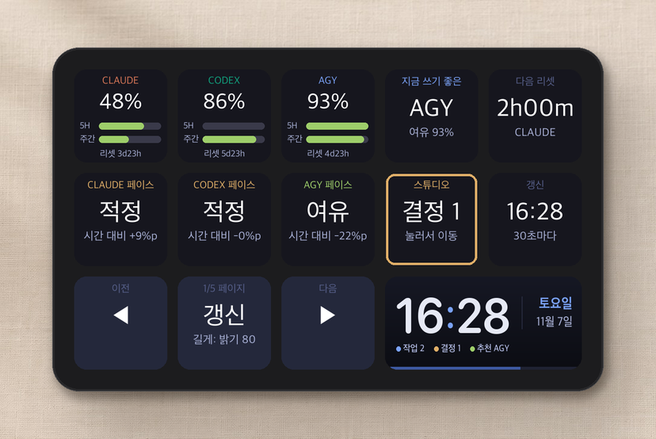
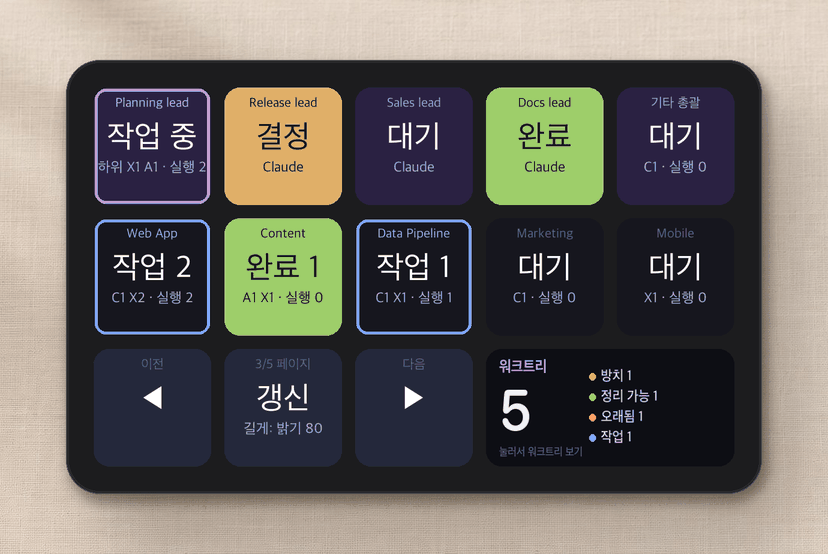
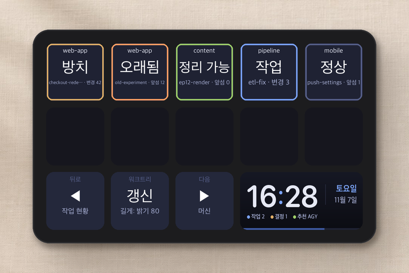
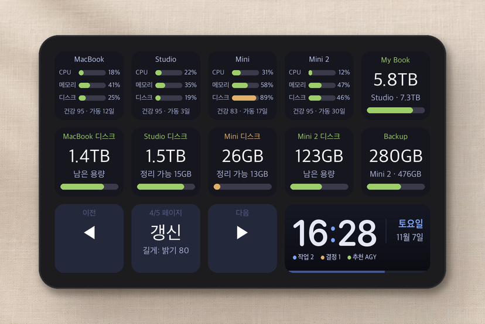
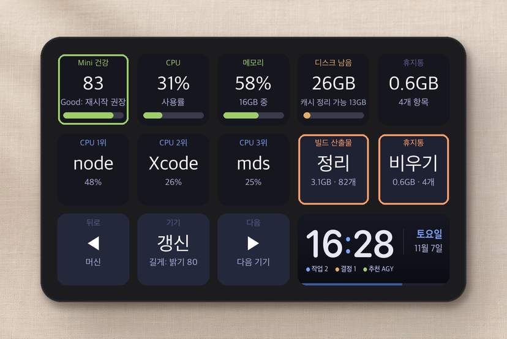
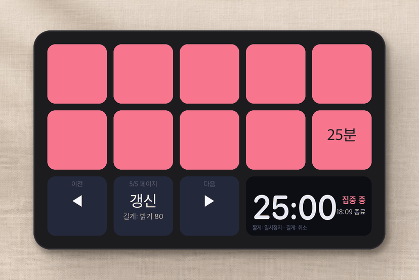

# agentdeck 사용 가이드

처음 쓰는 분도 따라 할 수 있게 **준비 → 설치 → 기능별 설정** 순서로 정리했어요.
모든 기능을 다 켤 필요는 없어요. **LLM 한도와 뽀모도로는 설치만 하면 바로 동작**하고, 나머지는 필요한 것만 골라서 켜면 됩니다.

[English](GUIDE.en.md) · [README로 돌아가기](../README.md)

## 목차

1. [준비물](#1-준비물)
2. [설치](#2-설치)
3. [화면 기본 사용법](#3-화면-기본-사용법)
4. [기능별 상세](#4-기능별-상세)
   - [LLM 남은 한도 (1·2페이지)](#41-llm-남은-한도-12페이지)
   - [에이전트 작업 현황 (3페이지)](#42-에이전트-작업-현황-3페이지)
   - [워크트리](#43-워크트리)
   - [머신과 기기 상세 (4페이지)](#44-머신과-기기-상세-4페이지)
   - [뽀모도로 (5페이지)](#45-뽀모도로-5페이지)
5. [설정 파일 전체 설명](#5-설정-파일-전체-설명)
6. [문제 해결](#6-문제-해결)
7. [제거하기](#7-제거하기)

---

## 1. 준비물

| 준비물 | 설명 |
|---|---|
| **Ulanzi Stream Controller D200** | 버튼 13개와 넓은 화면 칸이 있는 모델이에요. [알리익스프레스](https://www.aliexpress.com/w/wholesale-ulanzi-d200.html)나 [Ulanzi 공식 스토어](https://www.ulanzi.com/products/stream-deck-d200)에서 살 수 있어요. ⚠️ 이름이 비슷한 **D200X**(노브 포함)와 **D200H**는 다른 모델이라 동작을 확인하지 않았습니다. 상품명에 **D200**만 있는지 확인하세요. |
| **macOS 컴퓨터** | Apple Silicon 맥에서 테스트했어요. |
| **USB 케이블** | 장치에 들어 있는 USB-C 케이블을 맥에 직접 연결하세요. |

> 💡 **펌웨어는 건드리지 않아요.** 이 프로그램은 맥에서 돌면서 장치에 화면을 보내기만 합니다. 프로그램을 끄면 장치는 원래대로 돌아가요.

## 2. 설치

### 2-1. 기본 도구 확인

터미널을 열고(Spotlight에서 "터미널" 검색) 아래를 입력해 보세요.

```bash
python3 --version   # Python 3.11 이상이면 OK
git --version
```

없다고 나오면 [Homebrew](https://brew.sh)를 설치한 뒤 다음을 실행하세요.

```bash
brew install python git
```

### 2-2. 내려받고 설치하기

```bash
git clone https://github.com/jakeparkcolde/agentdeck.git
cd agentdeck
python3 -m venv .venv
.venv/bin/pip install -r requirements.txt
cp config.example.json config.json
```

### 2-3. 처음 실행

1. **Ulanzi Studio를 완전히 종료하세요.** 메뉴 막대 아이콘에서 종료까지 해 주세요. 두 프로그램이 장치를 동시에 쓰면 충돌합니다.
2. 장치를 USB로 연결하세요.
3. 실행합니다.
   ```bash
   .venv/bin/python dashboard.py
   ```
4. 장치 화면이 바뀌면 성공이에요. 끝내려면 터미널에서 `Ctrl+C`를 누르세요.

### 2-4. 맥을 켤 때 자동으로 실행하기

```bash
./scripts/install-launchd.sh
```

이제 로그인하면 자동으로 켜지고, 꺼지면 15초 안에 다시 켜집니다. USB를 뽑았다 꽂아도 알아서 다시 연결돼요.

| 하고 싶은 일 | 명령 |
|---|---|
| 설정을 바꾼 뒤 다시 시작 | `launchctl kickstart -k gui/$(id -u)/com.agentdeck.dashboard` |
| 로그 보기 | `tail -f dashboard.log` |

## 3. 화면 기본 사용법

```
┌────┬────┬────┬────┬────┐
│ 1  │ 2  │ 3  │ 4  │ 5  │   ← 페이지마다 바뀌는 칸 (10개)
├────┼────┼────┼────┼────┤
│ 6  │ 7  │ 8  │ 9  │ 10 │
├────┼────┼────┼─────────┤
│ ◀  │갱신│ ▶  │ 넓은 칸  │   ← 공통 버튼 + 넓은 칸 (시계 등)
└────┴────┴────┴─────────┘
```

| 버튼 | 짧게 누르기 | 길게 누르기 (0.8초 이상) |
|---|---|---|
| ◀ / ▶ | 이전 / 다음 페이지 | — |
| 가운데 | 지금 바로 새로고침 | 화면 밝기 변경 (20 → 50 → 80 → 100) |

**색의 의미**는 모든 페이지에서 같아요.

| 색 | 뜻 |
|---|---|
| 🟩 초록 | 여유 있음, 정상, 완료 |
| 🟨 노랑 | 주의, 내 결정이 필요함 |
| 🟥 빨강 | 위험, 거의 바닥남, 지우기 전 확인 대기 |
| 🟦 파랑 | 작업 중 |
| **깜빡임** | 지금 봐야 하는 알림이에요. 누르면 해당 위치로 이동하고 깜빡임이 멈춥니다. |

## 4. 기능별 상세

### 4.1 LLM 남은 한도 (1·2페이지)



**무엇을 보여주나요?**
- **Claude · Codex · agy**의 남은 한도를 5시간 기준과 주간 기준으로 보여줘요. 큰 숫자는 둘 중 **더 빠듯한 쪽**이에요.
- **페이스**: 한도를 시간보다 빨리 쓰고 있는지 알려줘요. 예를 들어 주간 한도의 50%를 썼는데 일주일 중 30%밖에 안 지났다면 "과속"이에요.
- **지금 쓰기 좋은**: 가장 여유 있는 LLM을 추천해요.
- **2페이지**는 같은 정보를 표처럼 보여줘요. 열은 LLM, 윗줄은 5시간, 아랫줄은 주간이에요.

**켜는 방법**

| LLM | 설정 |
|---|---|
| **Claude** | Claude Code 상태줄에 래퍼를 끼워야 해요. 아래 예시를 보세요. |
| **Codex** | Codex CLI에 로그인돼 있으면 자동이에요(`~/.codex/auth.json`). |
| **agy** | `config.json`의 `agy`에 agy를 쓰는 컴퓨터를 적어요. |

**Claude 설정 예시** (`~/.claude/settings.json`)

```jsonc
// 원래 상태줄 명령이 있었다면 뒤에 그대로 붙이세요
"statusLine": {
  "type": "command",
  "command": "/Users/나/agentdeck/statusline-tee.sh 원래명령"
}
// 상태줄을 안 쓰고 있었다면 래퍼만 넣으면 돼요
"statusLine": {"type": "command", "command": "/Users/나/agentdeck/statusline-tee.sh"}
```

> Claude 값은 Claude Code를 쓰는 동안에만 갱신돼요. 한동안 안 쓰면 마지막 값이 그대로 보여요.
> ⚠️ Codex와 agy 조회는 공식 문서가 없는 내부 API를 써요. 언제든 바뀔 수 있습니다.

### 4.2 에이전트 작업 현황 (3페이지)



**무엇을 보여주나요?** 지금 돌고 있는 Claude Code · Codex 에이전트를 **프로젝트별**로 묶어서 보여줘요.

| 표시 | 뜻 |
|---|---|
| **결정 N** (노랑 깜빡임) | 권한 승인이나 질문에 답해야 해요 |
| **완료 N** (초록 깜빡임) | 작업이 끝났는데 아직 확인하지 않았어요 |
| **작업 N** (파란 테두리) | 실행 중이에요 |
| **대기** | 다음 지시를 기다려요 |
| `C2 X1 · 실행 1` | C는 Claude, X는 Codex, A는 agy 개수이고, 뒤의 숫자는 지금 실행 중인 수예요 |

**눌렀을 때**
- 깜빡이는 칸을 누르면 **그 에이전트가 있는 창으로 이동**하고 깜빡임이 꺼져요.
- 같은 칸을 다시 누르면 그 프로젝트의 다음 세션이나 탭으로 넘어가요.

**두 가지 방식 중 하나를 고르세요** (`config.json`의 `agent_source`)

#### A. 훅 방식 (`"hooks"`, 추천)
VS Code, Cursor, iTerm, Ghostty, 기본 터미널 등 **어디서 돌든** 동작해요.

```bash
python3 scripts/install-hooks.py           # Claude Code
python3 scripts/install-hooks.py --codex   # Codex도 함께 (기존 notify 설정은 유지)
```

설치한 뒤 **새로 시작한 세션부터** 화면에 나타나요. 누르면 이렇게 이동합니다.

| 에이전트가 도는 곳 | 눌렀을 때 |
|---|---|
| iTerm2, 터미널 앱 | 그 탭으로 정확히 이동 |
| VS Code, Cursor | 그 프로젝트 창을 앞으로 |
| Ghostty 등 그 밖의 앱 | 그 앱을 앞으로 |
| 다른 맥 | 화면에 표시만 돼요 |

다른 맥의 에이전트도 보려면 그 맥에서도 `install-hooks.py`를 실행하고, `config.json`의 `hooks.hosts`에 SSH 주소를 추가하세요.

> 제외되는 것: 다른 프로그램이 `claude -p`처럼 비대화형으로 실행한 작업은 "하위 작업"으로 보고 알림을 띄우지 않아요. VS Code 확장 안의 에이전트처럼 CLI가 아닌 에이전트는 잡히지 않을 수 있어요.

#### B. Herdr 방식 (`"herdr"`)
[Herdr](https://herdr.dev)로 에이전트를 관리한다면 이 방식이 더 많은 기능을 줘요.
- 윗줄에 **리드(총괄) pane**과 하위 에이전트를 따로 보여줘요. pane을 누르면 그 pane을 **확대**하고, 다시 누르면 원래대로 돌아가요.
- `studio` 설정에 Herdr가 도는 컴퓨터, 리드 스페이스와 탭 이름, 리드 pane을 적어주세요. 자세한 내용은 [5. 설정 파일](#5-설정-파일-전체-설명)을 보세요.

### 4.3 워크트리



3페이지의 **넓은 칸을 누르면** 들어가요. git 워크트리를 상태별로 보여줍니다.

| 상태 | 뜻 | 길게 두 번 누르면 |
|---|---|---|
| 방치 | 커밋 안 한 변경이 있는데 아무도 작업하지 않아요 | 리드 에이전트에게 정리 요청을 보내요 |
| 정리 가능 | main에 모두 반영됐고 변경도 없어요 | 워크트리를 삭제해요 (브랜치는 남겨요) |
| 오래됨 | 반영 안 된 커밋이 있고 3일 넘게 손대지 않았어요 | 정리 요청 |
| 작업 | 에이전트가 그 폴더에서 일하는 중이에요 | 정리 요청 |

- **짧게 누르면** 그 워크트리를 열어요.
- **길게 누르면 빨간 확인 대기 상태가 되고, 10초 안에 한 번 더 길게 눌러야 실행돼요.** 실수로 지워지지 않게 하려는 거예요.
- 켜는 방법: `studio.host`(워크트리가 있는 컴퓨터)와 `studio.worktree_globs`(찾을 경로)를 설정하세요. 정리 요청은 `studio.lead_pane`으로 가는데, 이 기능은 지금 Herdr가 필요해요.

### 4.4 머신과 기기 상세 (4페이지)



**무엇을 보여주나요?** 여러 맥의 CPU, 메모리, 디스크와 외장 드라이브의 남은 용량이에요. [Mole](https://github.com/tw93/Mole)이 설치돼 있으면 **건강 점수**와 정리 가능한 용량도 보여줘요.

**컴퓨터 칸을 누르면 기기 상세 페이지**로 들어가요.



- CPU를 많이 쓰는 프로세스 3개를 보여주고, 5분 넘게 CPU를 과하게 쓰면 빨갛게 표시해요.
- **빌드 산출물 정리**: `node_modules`, `.venv`, `dist` 같은 빌드 결과물을 지워요(`mo purge`). ⚠️ 돌고 있는 프로젝트의 것도 지워질 수 있어서, 다시 설치가 필요할 수 있어요.
- **휴지통 비우기**: 영구 삭제예요.
- 두 버튼 모두 **길게 두 번 눌러야 실행**되고, 짧게 누르면 무엇을 지우는지 설명만 보여줘요.

**켜는 방법**

1. **다른 맥 연결 (선택)**: 비밀번호 없이 SSH로 접속할 수 있어야 해요. 가장 쉬운 방법은 모든 맥에 [Tailscale](https://tailscale.com)을 설치하는 거예요. 그다음 이 맥에서 아래를 실행합니다.
   ```bash
   ssh-keygen -t ed25519            # 키가 없을 때만
   ssh-copy-id 사용자@상대맥이름
   ssh 사용자@상대맥이름 echo ok      # ok 가 나오면 성공
   ```
2. **Mole 설치 (선택)**: 각 맥에서 `brew install mole`
3. `config.json`의 `machines`에 컴퓨터를 추가하세요. 이 맥은 `"ssh": null`, Mole이 있으면 `"mole": true`로 적어요.

### 4.5 뽀모도로 (5페이지)



1. 5분부터 90분까지 원하는 시간을 누르면 바로 시작해요.
2. 10칸이 **마지막 칸부터 거꾸로** 비워져요. 넓은 칸에는 남은 시간과 끝나는 시각이 나와요.
3. 아무 칸이나 **짧게 누르면 일시정지**하고, 그때 나타나는 "취소" 칸을 누르거나 **길게 누르면 취소**돼요.
4. 끝나면 어느 페이지를 보고 있든 5페이지로 넘어가서 깜빡이고, 맥 알림과 소리로 알려줘요.

> 대시보드가 다시 시작돼도 타이머는 이어집니다.

## 5. 설정 파일 전체 설명

`config.json` 하나로 모든 기능을 설정해요. **적지 않은 기능은 꺼집니다.** 바꾼 뒤에는 대시보드를 다시 시작하세요.

```jsonc
{
  "ui_lang": "ko",              // 화면 언어: "ko" 또는 "en"
  "agent_source": "hooks",      // 에이전트 현황 방식: "hooks" 또는 "herdr"
  "hooks": {
    "hosts": [null, "studio"]   // 훅 상태를 읽을 컴퓨터 (null = 이 맥)
  },
  "machines": [                 // 4페이지에 보일 컴퓨터
    {"name": "MacBook", "ssh": null,     "mole": true},
    {"name": "Studio",  "ssh": "studio", "mole": true}
  ],
  "external_drives": [          // 보여줄 외장 드라이브 (볼륨 이름, 연결된 컴퓨터 이름)
    {"volume": "My Book", "machine": "Studio"}
  ],
  "studio": {                   // Herdr 방식 + 워크트리
    "enabled": true,
    "host": "studio",           // Herdr와 워크트리가 있는 컴퓨터
    "tower_space": "CONTROL_TOWER",
    "tower_main_tab": "lead",
    "lead_pane": "t1",          // 정리 요청을 받을 리드 pane
    "worktree_globs": ["~/worktrees/*/*"]
  },
  "agy": {"enabled": true, "host": "studio"}
}
```

## 6. 문제 해결

| 증상 | 해결 |
|---|---|
| 화면이 안 바뀌어요 | Ulanzi Studio를 완전히 종료하고, 장치를 다시 꽂고, 대시보드를 다시 시작하세요 |
| 버튼을 누르면 글자가 입력돼요 | 대시보드가 꺼져 있어서 장치가 기본 키보드 모드로 동작하는 거예요. `dashboard.log`에서 오류를 확인하세요 |
| 에이전트가 안 보여요 (훅 방식) | 훅을 설치한 뒤 **새로 시작한 세션**부터 보여요. `ls ~/.cache/d200/agents`에 파일이 생기는지 확인하세요 |
| 다른 맥 칸이 "OFF"예요 | `ssh 주소 echo ok`가 비밀번호 없이 되는지 확인하세요 |
| 맥북 휴지통 비우기를 누르면 권한을 물어요 | 처음 한 번 "Finder 제어 허용"을 눌러주세요 |
| Claude 한도가 "-"예요 | 상태줄 래퍼 설정을 확인하고 Claude Code를 한 번 사용하세요 |

## 7. 제거하기

```bash
launchctl bootout gui/$(id -u)/com.agentdeck.dashboard
rm ~/Library/LaunchAgents/com.agentdeck.dashboard.plist
python3 scripts/install-hooks.py --uninstall   # 훅을 설치했다면
```

Claude 상태줄 설정은 원래대로 되돌리고, 폴더를 지우면 끝이에요. 장치는 Ulanzi Studio로 바로 다시 쓸 수 있어요.
